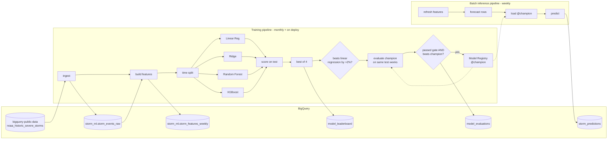
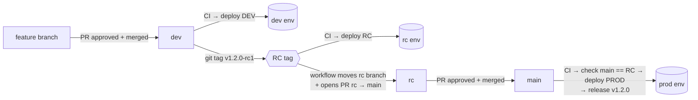

# Storm Event Forecasting on Vertex AI Pipelines

End-to-end MLOps project that forecasts **how many severe storm events each US state will see next week**.
It uses the public **NOAA Storm Events** database in **BigQuery** and runs on **Vertex AI Pipelines** (Kubeflow Pipelines v2).
It has two pipelines, a **monthly training pipeline** (which ends with an evaluation stage) and a **weekly batch inference pipeline**, plus a GitHub Actions CI/CD workflow.

| | |
|---|---|
| **Data** | `bigquery-public-data.noaa_historic_severe_storms.storms_*` (NOAA NCEI Storm Events, 1950 to present) |
| **Storage** | BigQuery (raw table, feature table, leaderboard, evaluations, predictions) |
| **Task** | Regression: weekly storm event count per state, one week ahead |
| **Baselines** | 1. Linear Regression (OLS) 2. Ridge Regression (L2-regularised linear) |
| **Non-linear models** | 3. Random Forest 4. **XGBoost** |
| **Orchestration** | Vertex AI Pipelines, KFP v2 SDK, Vertex AI Model Registry, pipeline schedules |
| **CI/CD** | GitHub Actions + Workload Identity Federation + Artifact Registry (Docker and KFP templates) |

---

## 1. Architecture



## 2. Dataset and problem framing

**Source.** NOAA's [Storm Events Database](https://www.ncdc.noaa.gov/stormevents/) is published as a BigQuery public dataset with one table per year (`storms_1950` … `storms_<latest>`).
Each row is a reported event (tornado, hail, thunderstorm wind, flash flood, …) with location, time, casualties and damage.

**Why it is stored in BigQuery.** The first pipeline step copies the selected years from the public dataset into our own dataset (`storm_ml.storm_events_raw`).
That table is partitioned by month and clustered by `state, event_type`.
All downstream feature engineering then runs as SQL inside BigQuery (`src/storm_prediction/sql/`), and only the compact weekly feature table is pulled into the training containers.

> The public dataset is in the **US multi-region**, so `storm_ml` must also be created in `US`. BigQuery cannot run a cross-region `CREATE TABLE AS SELECT`.

**Target.** `event_count` is the number of storm events in `(state, ISO week)`.
Weeks without events are explicit zeros, produced from a dense state×week calendar.

**Features** (`build_features.sql`) are all computed from weeks strictly before the target week, so no information leaks from the future:

| Group | Features |
|---|---|
| Seasonality | `month`, `week_of_year_sin/cos` |
| Autoregressive | `lag_1..4`, `lag_52`, `same_week_mean_3y` |
| Rolling stats | `rolling_mean_4/12/52`, `rolling_std_12`, `state_expanding_mean` |
| Event mix (last 4 wks) | `tornado_sum_4`, `hail_sum_4`, `wind_sum_4`, `flood_sum_4` |
| Impact (last 12 wks) | `injuries_sum_12`, `deaths_sum_12`, `log_damage_sum_12` |
| Categorical | `state` (one-hot encoded) |

The feature table also holds one **forecast row per state** for the week after the last complete week (`is_forecast_row = TRUE`, target `NULL`).
The batch inference pipeline scores exactly those rows.

**Splits** are chronological: the last 52 weeks are test, the 52 before that are validation, and everything earlier is training.

## 3. Models

All four models share one preprocessing pipeline (median imputation, plus scaling for the linear models, plus one-hot `state`).
All are fit on `log1p(count)` through `TransformedTargetRegressor`, so the comparison is like-for-like (`src/storm_prediction/models.py`).

| # | Model | Role | Notes |
|---|---|---|---|
| 1 | `LinearRegression` | baseline | plain OLS |
| 2 | `Ridge` | baseline | L2 regularisation, stable with correlated lags |
| 3 | `RandomForestRegressor` | non-linear | non-linear and interaction effects |
| 4 | `XGBRegressor` | non-linear | gradient-boosted trees (`hist`) |

Every monthly training run applies three rules:

1. **Selection:** train all four models and pick **the best of the four**, meaning the lowest validation RMSE.
2. **Baseline gate:** the winner's test RMSE must beat the **Linear Regression** baseline's test RMSE by **more than 2%** (`min_improvement_over_baseline_pct`).
   If Linear Regression itself wins, the improvement is 0% and the gate fails.
3. **Champion check:** the winner must also beat the current champion on the same test weeks, by at least `min_improvement_over_champion_pct` (default `0`, meaning any improvement).

A model is registered as the new champion only if it passes **both** 2 and 3. Otherwise nothing is registered and the current champion stays live.

Metrics logged per model: RMSE, MAE, R², WAPE, Poisson deviance, bias.

## 4. Pipelines

| Pipeline | File | Schedule | Output |
|---|---|---|---|
| **Training** (includes evaluation) | `pipelines/training_pipeline.py` | **monthly** (1st of the month, 04:00 UTC), plus once on every deploy | leaderboard and promotion decision in BigQuery; new champion in the Model Registry if it won |
| **Batch inference** | `pipelines/batch_inference_pipeline.py` | weekly (Mon 06:00 UTC) | `storm_predictions` rows (forecast + `risk_level`) |

There is no separate evaluation pipeline and no weekly evaluation. Evaluation runs only as the last stage of a training run.
There is also no automatic retraining trigger: retraining happens on the monthly schedule (and on deploy), whatever the current model's performance.

**Training stage:** `ingest → build features → time split → 4× (train → score on test) in parallel → best of 4 (validation RMSE) → baseline gate (beat Linear Regression by > 2%) → write leaderboard`.

**Evaluation stage (starts after training finishes):**
1. Load the current `champion` from the Model Registry and score it on **the same test weeks** as the new model. Both models are scored on data neither was trained on, so the comparison is fair.
2. Decide: promote only if the new model **passed the baseline gate** and its test RMSE is lower than the champion's (by `min_improvement_over_champion_pct`).
   If there is no champion yet (first run), or the champion can't score the current features, passing the baseline gate is enough.
   A model that fails the baseline gate is never promoted, not even on the first run.
3. Log the decision to BigQuery (`model_evaluations`) and as a Markdown report in the Vertex AI UI.
4. If promoted, register the new model as a new version and move the `champion` alias to it. Otherwise nothing is registered and the old champion stays live.

Each monthly run loads data up to the current year (`end_year: 0`), so it trains on whatever NOAA has published since the last run.

**Batch inference:** `refresh features → extract forecast rows → load @champion → predict → append to BigQuery`.
Each prediction row carries `model_version`, `model_type`, `pipeline_job_name` and `scored_at` for lineage.

> Batch scoring runs inside a pipeline component rather than through `ModelBatchPredictOp`.
> The model is an sklearn `Pipeline` that may contain XGBoost, and Vertex's prebuilt sklearn container cannot load that.
> The Model Registry is used for versioning, lineage and aliases.
> To serve online, set `model.serving_container_image_uri` to a Custom Prediction Routine image.

### BigQuery tables (dataset `storm_ml`)

| Table | Written by | Grain |
|---|---|---|
| `storm_events_raw` | all pipelines (ingest) | one storm event |
| `storm_features_weekly` | all pipelines (features) | state × week |
| `model_leaderboard` | training | model × training run |
| `model_evaluations` | training (evaluation stage) | training run: new model vs champion, promoted or not |
| `storm_predictions` | batch inference | state × forecast week × run |

## 5. Repository layout

```
.
├── .github/workflows/               # CI/CD: ci-cd.yaml (dev → rc → prod)            [README]
├── configs/                         # dev.yaml, rc.yaml, prod.yaml                     [README]
├── infra/                           # setup_gcp.sh: one-time GCP bootstrap             [README]
├── scripts/                         # compile_pipelines.py, run_pipeline.py            [README]
├── src/storm_prediction/            # the Python package                               [README]
│   ├── sql/                         #   BigQuery: raw ingestion + weekly features      [README]
│   ├── components/                  #   KFP components (pipeline steps)                [README]
│   ├── pipelines/                   #   training, evaluation, batch inference          [README]
│   └── models.py features.py metrics.py data.py gcp.py config.py
├── tests/                           # unit + pipeline compilation tests                [README]
├── Dockerfile                       # single image used by every component
└── Makefile  pyproject.toml  requirements*.txt
```

Every folder has its own `README.md` describing its files in more detail.

Every component runs in **one custom image** that has the `storm_prediction` package installed.
The component functions stay thin and import tested library code, and the image tag is injected at compile time through `PIPELINE_IMAGE`.

## 6. Getting started

### Prerequisites
- A GCP project with billing, plus `gcloud` and `bq` CLIs
- Python 3.10+ (CI uses 3.12)

### 6.1 Bootstrap GCP (once per environment)
```bash
PROJECT_ID=my-storm-dev GITHUB_REPO=my-org/storm-prediction-vertex ./infra/setup_gcp.sh
```
This enables the APIs and creates:
- bucket `gs://<project>-storm-ml`
- BigQuery dataset `storm_ml` (US)
- Artifact Registry repos `storm-ml` (Docker) and `storm-pipelines` (KFP)
- service accounts `vertex-pipelines` (runtime) and `github-deployer` (CI)
- the Workload Identity Federation pool for GitHub

### 6.2 Local development
```bash
python -m venv .venv && source .venv/bin/activate
```
```bash
make install
```
```bash
make lint test
```
```bash
export GCP_PROJECT_ID=my-storm-dev
```
```bash
make compile
```

### 6.3 Build the image and run manually
```bash
make image
```
```bash
make run-training ENV=dev
```
```bash
make run-batch ENV=dev
```
Run training first: batch inference needs a `champion` model in the registry.

### 6.4 Useful queries
```sql
-- promotion history: was the new model better than the champion?
SELECT evaluated_at, new_model_type, new_test_rmse, champion_model_type, champion_test_rmse, promoted, reason
FROM `storm_ml.model_evaluations`
ORDER BY evaluated_at DESC;

-- leaderboard of the latest training run
SELECT model_type, is_baseline, val_rmse, test_rmse, test_mae, test_r2
FROM `storm_ml.model_leaderboard`
WHERE pipeline_job_name = (SELECT MAX(pipeline_job_name) FROM `storm_ml.model_leaderboard`)
ORDER BY rank;

-- latest weekly forecast, riskiest states first
SELECT state, forecast_week_start, ROUND(predicted_event_count, 1) AS predicted_events, risk_level
FROM `storm_ml.storm_predictions`
WHERE scored_at = (SELECT MAX(scored_at) FROM `storm_ml.storm_predictions`)
ORDER BY predicted_event_count DESC;
```

## 7. CI/CD (`.github/workflows/ci-cd.yaml`)

### Branches, tags and environments

| Branch / tag | Purpose | GitHub environment / GCP project |
|---|---|---|
| feature branches | day-to-day work | — |
| `dev` | integration branch; every approved merge deploys | `dev` |
| tag `vX.Y.Z-rcN` on `dev` | release candidate | `rc` |
| `rc` | maintained by the workflow; always equals the latest deployed RC tag | — |
| `main` | production; changes arrive only through the `rc` → `main` PR | `prod` |

### Release flow



Nothing runs when a pull request is opened or updated. Every run starts after a merge or a tag:

1. **Feature → `dev`.** Open a PR into `dev`. When it is approved and merged, CI runs (ruff, pytest with coverage, compile all pipelines), then the code deploys to **dev**.
2. **`dev` → RC (tag).** When dev looks good, tag that commit and push the tag:
   ```bash
   git tag v1.2.0-rc1 origin/dev
   ```
   ```bash
   git push origin v1.2.0-rc1
   ```
   CI runs and the tagged commit deploys to the **rc** environment. The workflow then force-moves the `rc` branch to the tag and opens (or updates) a PR titled `Release v1.2.0 (v1.2.0-rc1)` from `rc` into `main`.
   If the RC has a problem, fix it on `dev` and tag `v1.2.0-rc2`. The same PR updates to the new RC.
3. **RC → `main` (PR).** Review and approve the release PR, then merge it. CI runs, then the `plan` job checks that `main` now has exactly the same content as an RC tag. If it does, the code deploys to **prod** and the workflow publishes GitHub release `v1.2.0`.

**Guards** (in the `plan` job):
- An RC tag must match `vX.Y.Z-rcN` and point at a commit on `dev`.
- A merge into `main` deploys only if its file tree is identical to an RC tag, so prod runs exactly what was tested in rc. Merge, squash and rebase merges all pass this check. A commit pushed straight to `main`, or a PR from any branch other than `rc`, fails it.
- A version that has already been released can't be released again; cut a new RC with a higher version.
- Manual runs (`workflow_dispatch`) let you redeploy any environment. A prod redeploy or rollback must start from `main` or a release tag. To roll back, run the workflow on tag `v1.1.0` with environment `prod`.

**Hotfixes** follow the same path: PR into `dev`, tag `vX.Y.Z-rc1`, merge the release PR. There is no shortcut that skips rc.

### What the deploy job does
1. Authenticates to GCP with Workload Identity Federation (no service-account keys).
2. Builds and pushes the component image, tagged `sha-<commit>`.
3. Compiles the pipelines against that image and publishes the templates to the Artifact Registry KFP repo, tagged `latest`, `sha-<commit>`, the version (`v1-2-0-rc1`) and the environment name.
4. Submits one training run right away, so the new code produces a champion without waiting for the 1st of the month.
5. Recreates the two **schedules**, monthly training and weekly batch inference, so they point at the new template version.

### One-time GitHub setup

1. **Create the branches.** Create `dev` from `main`. The workflow creates `rc` the first time an RC deploys.
2. **Create three environments** (Settings → Environments): `dev`, `rc` and `prod`, one GCP project each, bootstrapped with `infra/setup_gcp.sh`. Set these values in each:

   | Name | Type | Example |
   |---|---|---|
   | `GCP_PROJECT_ID` | variable | `my-storm-rc` |
   | `WIF_PROVIDER` | secret | `projects/123/locations/global/workloadIdentityPools/github/providers/github-oidc` |
   | `DEPLOYER_SA` | secret | `github-deployer@my-storm-rc.iam.gserviceaccount.com` |

   Add required reviewers to `rc` and `prod` if you want a second approval before those deploys start.
3. **Protect the branches** (Settings → Rules → Rulesets):
   - `dev` and `main`: require a pull request with at least 1 approval, and block direct pushes and force pushes.
   - `rc`: block direct pushes for everyone except the GitHub Actions bot, which force-moves it.
4. **Let Actions open PRs:** Settings → Actions → General → Workflow permissions → tick "Allow GitHub Actions to create and approve pull requests".
5. **Protect tags:** add a tag ruleset on `v*` so only maintainers can create release-candidate tags.

### Why a tag for dev → rc, but a PR for rc → main
- **dev → rc is a snapshot, so a tag fits.** It freezes an exact commit and gives it a version. No new merge commit is created, so rc runs exactly what was in dev, and every RC can be named, compared and redeployed later.
- **rc → main is an approval, so a PR fits.** The PR records who approved the release and when, and it shows the full diff between prod and the release.
- **The usual weakness of branch promotion is closed.** Normally, merging into `main` can bring in code that never ran in the earlier environment. Here the `plan` job blocks prod unless `main` equals a tested RC tag.

## 8. Design decisions

- **Features are computed in BigQuery.** Window functions over about 1,300 weeks × 51 states are cheap there, and the SQL is the single source of truth for training and inference, so the two cannot skew apart.
- **Leakage control.** Every window ends at `1 PRECEDING`, the splits are chronological, and a unit test fails if `CURRENT ROW` ever appears in a window.
- **Log-target for every model.** Event counts are heavy-tailed, and fitting `log1p(y)` stops linear models from being dominated by a few extreme weeks. Predictions are clipped at 0.
- **Best of four, every month.** Each retraining run re-runs the whole model comparison on the latest data, so the chosen model type can change over time.
- **The linear baseline as a gate.** The extra complexity of Ridge, Random Forest or XGBoost must earn its place: a model that doesn't beat plain Linear Regression by more than 2% is not shipped.
- **Like-for-like promotion.** The new model and the champion are compared on identical test weeks, never against an RMSE recorded months earlier on different data.
- **Champion alias in the registry.** Batch inference always resolves `model@champion`, so promotion and rollback are a single alias move with no redeploy.
- **Simple schedule instead of triggers.** Retraining is a fixed monthly schedule, not a drift trigger. That is predictable in cost and easy to reason about, and NOAA data only arrives in monthly batches anyway.
- **Caching is disabled on data steps.** BigQuery tables change between runs; model training on identical inputs can still use the cache.

## 9. Limitations and next steps

- The SQL follows the documented schema of the public NOAA tables. Before the first production run, check the `event_type` spellings against the live dataset.
- NOAA publishes Storm Events with a delay of a few months, so the "next week" forecast is relative to the latest available data. For true real-time use, add a near-real-time source such as NWS Local Storm Reports.
- Add exogenous weather drivers, for example `bigquery-public-data.noaa_gsod` (temperature, precipitation, wind) joined by state.
- Add hyperparameter tuning (Vertex AI Vizier) for XGBoost and Random Forest.
- Add prediction intervals (quantile XGBoost) and a Looker Studio dashboard on `storm_predictions`.
- There is no performance monitoring between monthly runs. If that is ever needed, add a dashboard on `model_evaluations` and `storm_predictions`, or Vertex AI Model Monitoring.
