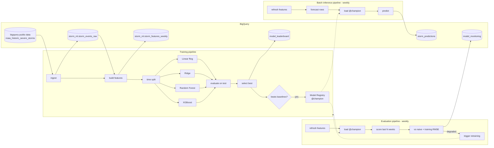

# Storm Event Forecasting on Vertex AI Pipelines

End-to-end MLOps project that forecasts **how many severe storm events each US state will see next week**.
It uses the public **NOAA Storm Events** database in **BigQuery** and runs on **Vertex AI Pipelines** (Kubeflow Pipelines v2).
It has three pipelines (training, evaluation/monitoring, batch inference) and a GitHub Actions CI/CD workflow.

| | |
|---|---|
| **Data** | `bigquery-public-data.noaa_historic_severe_storms.storms_*` (NOAA NCEI Storm Events, 1950 to present) |
| **Storage** | BigQuery (raw table, feature table, leaderboard, monitoring, predictions) |
| **Task** | Regression: weekly storm event count per state, one week ahead |
| **Baselines** | 1. Linear Regression (OLS) 2. Ridge Regression (L2-regularised linear) |
| **Challengers** | 3. Random Forest 4. **XGBoost** |
| **Orchestration** | Vertex AI Pipelines, KFP v2 SDK, Vertex AI Model Registry, pipeline schedules |
| **CI/CD** | GitHub Actions + Workload Identity Federation + Artifact Registry (Docker and KFP templates) |

---

## 1. Architecture



## 2. Dataset and problem framing

**Source.** NOAA's [Storm Events Database](https://www.ncdc.noaa.gov/stormevents/) is published as a BigQuery public dataset with one table per year (`storms_1950` … `storms_<latest>`).
Each row is a reported event (tornado, hail, thunderstorm wind, flash flood, …) with location, time, casualties and damage.

**Why it is stored in BigQuery.** The first pipeline step copies the selected years from the public dataset into our own dataset (`storm_ml.storm_events_raw`).
That table is partitioned by month and clustered by `state, event_type`.
All downstream feature engineering then runs as SQL inside BigQuery (`src/storm_prediction/sql/`), and only the compact weekly feature table is pulled into the training containers.

> The public dataset is in the **US multi-region**, so `storm_ml` must also be created in `US`. BigQuery cannot run a cross-region `CREATE TABLE AS SELECT`.

**Target.** `event_count` is the number of storm events in `(state, ISO week)`.
Weeks without events are explicit zeros, produced from a dense state×week calendar.

**Features** (`build_features.sql`) are all computed from weeks strictly before the target week, so no information leaks from the future:

| Group | Features |
|---|---|
| Seasonality | `month`, `week_of_year_sin/cos` |
| Autoregressive | `lag_1..4`, `lag_52`, `same_week_mean_3y` |
| Rolling stats | `rolling_mean_4/12/52`, `rolling_std_12`, `state_expanding_mean` |
| Event mix (last 4 wks) | `tornado_sum_4`, `hail_sum_4`, `wind_sum_4`, `flood_sum_4` |
| Impact (last 12 wks) | `injuries_sum_12`, `deaths_sum_12`, `log_damage_sum_12` |
| Categorical | `state` (one-hot encoded) |

The feature table also holds one **forecast row per state** for the week after the last complete week (`is_forecast_row = TRUE`, target `NULL`).
The batch inference pipeline scores exactly those rows.

**Splits** are chronological: the last 52 weeks are test, the 52 before that are validation, and everything earlier is training.

## 3. Models

All four models share one preprocessing pipeline (median imputation, plus scaling for the linear models, plus one-hot `state`).
All are fit on `log1p(count)` through `TransformedTargetRegressor`, so the comparison is like-for-like (`src/storm_prediction/models.py`).

| # | Model | Role | Notes |
|---|---|---|---|
| 1 | `LinearRegression` | baseline | plain OLS |
| 2 | `Ridge` | baseline | L2 regularisation, stable with correlated lags |
| 3 | `RandomForestRegressor` | challenger | non-linear and interaction effects |
| 4 | `XGBRegressor` | challenger | gradient-boosted trees (`hist`) |

**Selection rule:** the winner is chosen on validation RMSE and reported on test RMSE.
It is registered only if it is a challenger **and** beats the best linear baseline on test RMSE by at least `min_improvement_pct` (default 2%).
In the registry, a new version takes the `champion` alias only if its test RMSE beats the current champion's; otherwise it is tagged `challenger`.

Metrics logged per model: RMSE, MAE, R², WAPE, Poisson deviance, bias.

## 4. Pipelines

| Pipeline | File | Schedule | Output |
|---|---|---|---|
| **Training** | `pipelines/training_pipeline.py` | on deploy / on demand / auto-retrain | leaderboard in BQ + Markdown report in Vertex UI, model version in the Model Registry |
| **Evaluation** | `pipelines/evaluation_pipeline.py` | weekly (Mon 05:00) | `model_monitoring` row; triggers retraining if needed |
| **Batch inference** | `pipelines/batch_inference_pipeline.py` | weekly (Mon 06:00) | `storm_predictions` rows (forecast + `risk_level`) |

**Training:** `ingest → build features → split → 4× (train → evaluate) in parallel → select best → write leaderboard → [if beats baselines] register`.

**Evaluation (monitoring):** this pipeline refreshes the data and loads `model@champion`.
It scores the champion on the latest `lookback_weeks` of labelled data and compares it with:
- its own training-time test RMSE (stored as a model label); a degradation above `max_rmse_degradation_pct` is flagged;
- naive baselines (persistence = last week; seasonal naive = 3-year same-week mean); a champion that does no better than naive is flagged.

If flagged and `auto_retrain=true`, it submits the training pipeline template from Artifact Registry.

**Batch inference:** `refresh features → extract forecast rows → load @champion → predict → append to BigQuery`.
Each prediction row carries `model_version`, `model_type`, `pipeline_job_name` and `scored_at` for lineage.

> Batch scoring runs inside a pipeline component rather than through `ModelBatchPredictOp`.
> The model is an sklearn `Pipeline` that may contain XGBoost, and Vertex's prebuilt sklearn container cannot load that.
> The Model Registry is used for versioning, lineage and aliases.
> To serve online, set `model.serving_container_image_uri` to a Custom Prediction Routine image.

### BigQuery tables (dataset `storm_ml`)

| Table | Written by | Grain |
|---|---|---|
| `storm_events_raw` | all pipelines (ingest) | one storm event |
| `storm_features_weekly` | all pipelines (features) | state × week |
| `model_leaderboard` | training | model × training run |
| `model_monitoring` | evaluation | evaluation run |
| `storm_predictions` | batch inference | state × forecast week × run |

## 5. Repository layout

```
.
├── .github/workflows/ci-cd.yaml        # CI (lint/test/compile) + CD (image, templates, runs, schedules)
├── configs/{dev,prod}.yaml             # environment config (${GCP_PROJECT_ID} is expanded)
├── infra/setup_gcp.sh                  # one-time GCP bootstrap (APIs, bucket, BQ, AR, SAs, WIF)
├── scripts/
│   ├── compile_pipelines.py            # compile → build/*.yaml, optional push to Artifact Registry
│   └── run_pipeline.py                 # submit a run or (re)create a schedule
├── src/storm_prediction/
│   ├── sql/ingest_raw.sql              # public NOAA → our raw table
│   ├── sql/build_features.sql          # leak-free weekly features + forecast rows
│   ├── components/                     # KFP components
│   │   ├── data.py                     #   ingest, features, splits, eval window, scoring rows
│   │   ├── training.py                 #   train, evaluate, select, leaderboard, register
│   │   ├── monitoring.py               #   load registry model, naive baselines, health check, retrain trigger
│   │   └── inference.py                #   batch predict → BigQuery
│   ├── pipelines/                      # the three @dsl.pipeline definitions
│   ├── models.py  features.py  metrics.py  data.py  gcp.py  config.py
├── tests/                              # unit tests + pipeline compilation tests
├── Dockerfile                          # single image used by every component
├── Makefile  pyproject.toml  requirements*.txt
```

Every component runs in **one custom image** that has the `storm_prediction` package installed.
The component functions stay thin and import tested library code, and the image tag is injected at compile time through `PIPELINE_IMAGE`.

## 6. Getting started

### Prerequisites
- A GCP project with billing, plus `gcloud` and `bq` CLIs
- Python 3.10+ (CI uses 3.12)

### 6.1 Bootstrap GCP (once per environment)
```bash
PROJECT_ID=my-storm-dev GITHUB_REPO=my-org/storm-prediction-vertex ./infra/setup_gcp.sh
```
This enables the APIs and creates:
- bucket `gs://<project>-storm-ml`
- BigQuery dataset `storm_ml` (US)
- Artifact Registry repos `storm-ml` (Docker) and `storm-pipelines` (KFP)
- service accounts `vertex-pipelines` (runtime) and `github-deployer` (CI)
- the Workload Identity Federation pool for GitHub

### 6.2 Local development
```bash
python -m venv .venv && source .venv/bin/activate
```
```bash
make install
```
```bash
make lint test
```
```bash
export GCP_PROJECT_ID=my-storm-dev
```
```bash
make compile
```

### 6.3 Build the image and run manually
```bash
make image
```
```bash
make run-training ENV=dev
```
```bash
make run-batch ENV=dev
```
```bash
make run-evaluation ENV=dev
```
Run training first: the evaluation and batch pipelines need a `champion` model in the registry.

### 6.4 Useful queries
```sql
-- leaderboard of the latest training run
SELECT model_type, is_baseline, val_rmse, test_rmse, test_mae, test_r2
FROM `storm_ml.model_leaderboard`
WHERE pipeline_job_name = (SELECT MAX(pipeline_job_name) FROM `storm_ml.model_leaderboard`)
ORDER BY rank;

-- latest weekly forecast, riskiest states first
SELECT state, forecast_week_start, ROUND(predicted_event_count, 1) AS predicted_events, risk_level
FROM `storm_ml.storm_predictions`
WHERE scored_at = (SELECT MAX(scored_at) FROM `storm_ml.storm_predictions`)
ORDER BY predicted_event_count DESC;
```

## 7. CI/CD (`.github/workflows/ci-cd.yaml`)

| Trigger | Jobs |
|---|---|
| Pull request → `main` | **ci**: ruff lint, pytest (with coverage), compile all pipelines, upload compiled YAML as an artifact |
| Push → `main` | **ci** → **deploy (dev)** |
| Tag `v*` | **ci** → **deploy (prod)**; protect the `prod` GitHub environment with required reviewers |

The **deploy** job:
1. Authenticates to GCP with Workload Identity Federation (no service-account keys).
2. Builds and pushes the component image, tagged `sha-<commit>`.
3. Compiles the pipelines against that image and publishes the templates to the Artifact Registry KFP repo (tags `latest`, `sha-<commit>`, `<env>`).
4. Submits a training run.
5. Recreates the evaluation and batch-inference **schedules** so they point at the new template version.

Required settings for each GitHub environment (`dev`, `prod`):

| Name | Type | Example |
|---|---|---|
| `GCP_PROJECT_ID` | variable | `my-storm-dev` |
| `WIF_PROVIDER` | secret | `projects/123/locations/global/workloadIdentityPools/github/providers/github-oidc` |
| `DEPLOYER_SA` | secret | `github-deployer@my-storm-dev.iam.gserviceaccount.com` |

## 8. Design decisions

- **Features are computed in BigQuery.** Window functions over about 1,300 weeks × 51 states are cheap there, and the SQL is the single source of truth for training and inference, so the two cannot skew apart.
- **Leakage control.** Every window ends at `1 PRECEDING`, the splits are chronological, and a unit test fails if `CURRENT ROW` ever appears in a window.
- **Log-target for every model.** Event counts are heavy-tailed, and fitting `log1p(y)` stops linear models from being dominated by a few extreme weeks. Predictions are clipped at 0.
- **Baselines act as a gate.** A complex model ships only if it measurably beats both linear baselines. The evaluation pipeline adds model-free naive baselines as a second floor.
- **Champion/challenger through registry aliases.** Downstream pipelines always resolve `model@champion`, so promotion and rollback are a single alias move with no redeploy.
- **Caching is disabled on data steps.** BigQuery tables change between runs; model training on identical inputs can still use the cache.

## 9. Limitations and next steps

- The SQL follows the documented schema of the public NOAA tables. Before the first production run, check the year range (`end_year`) and the `event_type` spellings against the live dataset.
- NOAA publishes Storm Events with a delay of a few months, so the "next week" forecast is relative to the latest available data. For true real-time use, add a near-real-time source such as NWS Local Storm Reports.
- Add exogenous weather drivers, for example `bigquery-public-data.noaa_gsod` (temperature, precipitation, wind) joined by state.
- Add hyperparameter tuning (Vertex AI Vizier) for XGBoost and Random Forest.
- Add prediction intervals (quantile XGBoost) and a Looker Studio dashboard on `storm_predictions`.
- Add feature-drift monitoring on the feature table, beyond the current performance monitoring.
